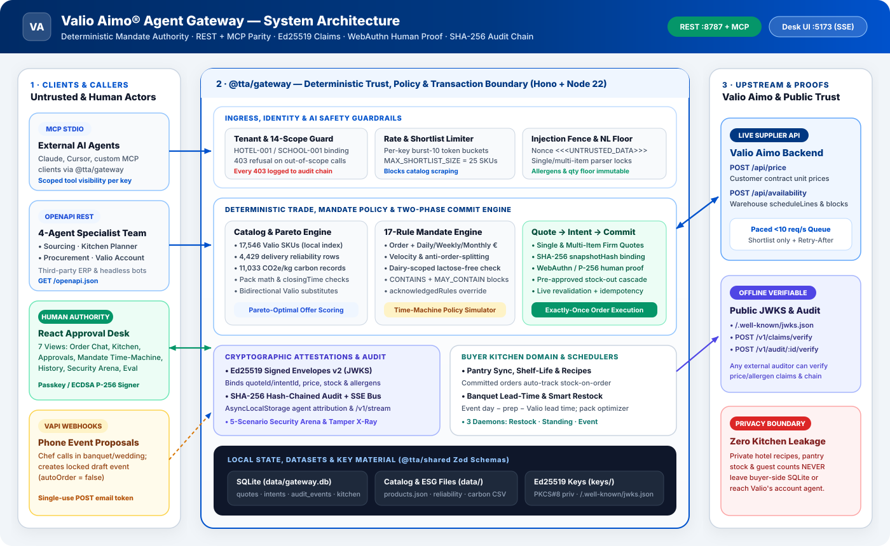
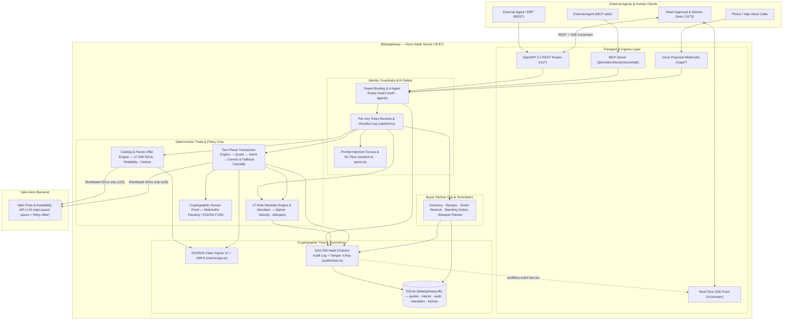
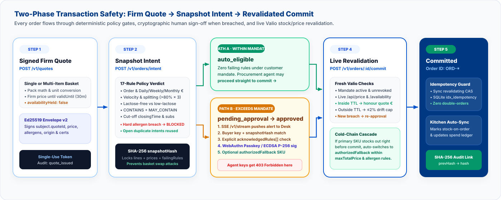
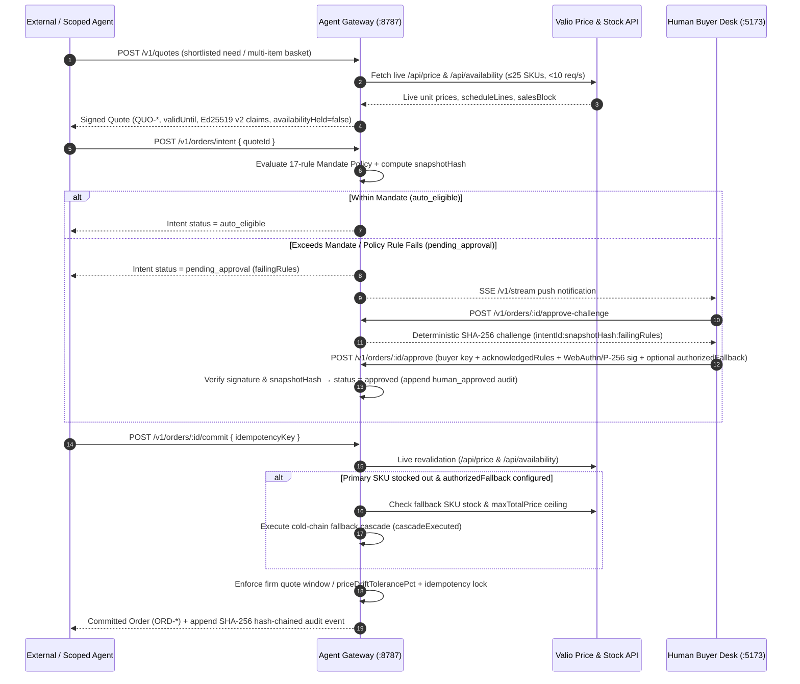
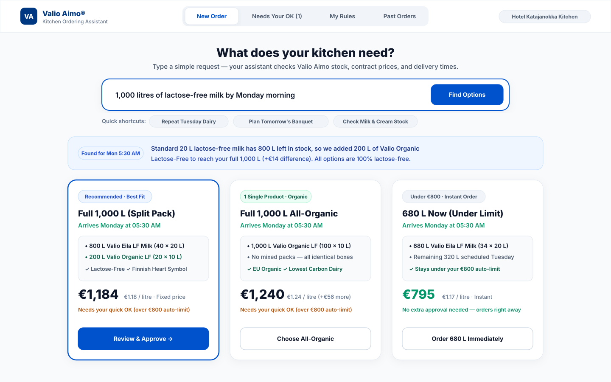
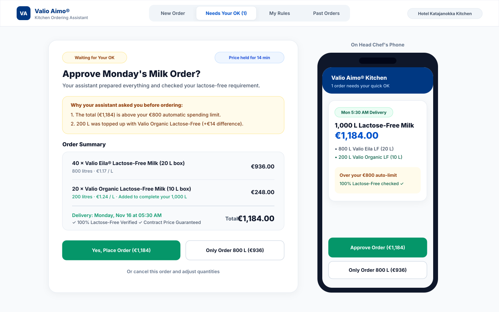
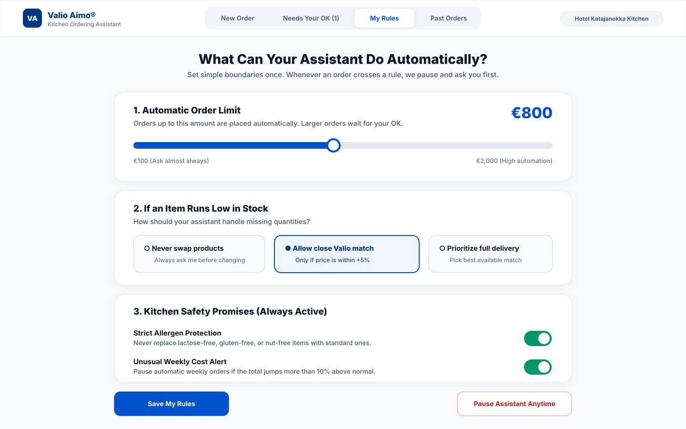
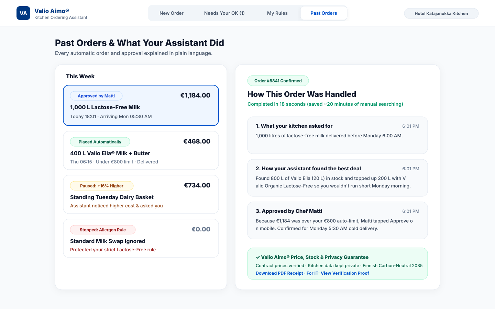
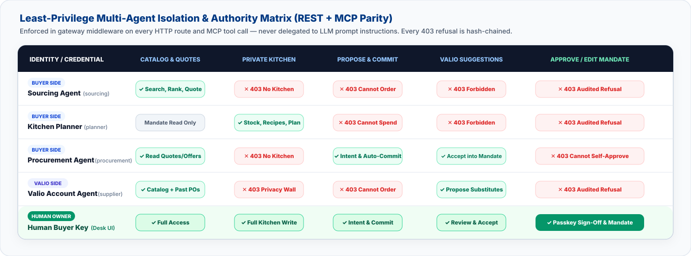

# Valio Aimo Agent Gateway — Trusted Trade Agents

**Product:** a safe open interface for *external* purchasing agents to look up products, compare fixed prices/availability, and commit orders under an explicit purchasing mandate — with cryptographic claims, least-privilege scopes, and human approval APIs when authority is exceeded.

We do **not** compete on how smart our LLM is. We compete on **how safely someone else’s agent can transact with Valio**.

---

## System Architecture

### Design Philosophy

1. **Deterministic Gateway Authority, Untrusted AI:** LLMs (internal chat coordinator or external third-party agents) only orchestrate tool calls. Scope checks, allergen/dietary floors, spend caps, mandate overrides, and commit-time revalidation execute deterministically inside gateway code.
2. **Protocol Parity (REST + MCP):** External agents connect via OpenAPI 3.1 REST or Model Context Protocol (`stdio` MCP). Both transports pass through identical authentication, per-key token-bucket rate limiting, capability checks, and audit logging.
3. **Verifiable Facts & Non-Repudiation:** Outbound price, stock, allergen, and origin claims are wrapped in canonical **Ed25519 v2 envelopes** (verifiable offline via `/.well-known/jwks.json`). Human mandate overrides bind a **WebAuthn / ECDSA P-256 cryptographic signature** to the basket's `snapshotHash` and failing rules, and every state transition or `403` refusal is recorded in an append-only **SHA-256 hash-chained SQLite audit log**.
4. **Upstream ERP Protection:** Catalog search runs locally against 17,546 indexed SKUs; live Valio `/api/price` and `/api/availability` calls are restricted to shortlisted SKUs (`MAX_SHORTLIST_SIZE = 25`) and paced through a serialized `<10 req/s` upstream queue.

### High-Level Component Topology



<details>
<summary><strong>View interactive Mermaid component graph</strong></summary>



</details>

### Monorepo Structure

The repository is organized as an npm workspaces monorepo (`apps/*`, `packages/*`):

| Workspace | Path | Responsibility |
|-----------|------|----------------|
| **`@tta/shared`** | `packages/shared/` | Versioned **Zod schemas & TypeScript contracts** shared across all packages: `Need`, `ComplexNeedResult`, `Mandate`, `SignedClaim` (Envelope v2), `ProductAttestation`, `BasketLine`, `Offer`, `PolicyVerdict`, and `OrderStatus`. |
| **`@tta/gateway`** | `apps/gateway/` | **Hono HTTP API (`:8787`) + `stdio` MCP server**. Houses authentication, multi-agent scope enforcement, local 17.5k-SKU catalog search, Valio upstream rate-paced client, Ed25519 signing, 17-rule policy engine, two-phase `Quote → Intent → Commit` store, WebAuthn/P-256 verification, SHA-256 audit chain, kitchen planners, background schedulers, and AI tool coordinator. |
| **`@tta/desk`** | `apps/desk/` | **React + Vite buyer control plane (`:5173`)**. Connects to the gateway using the human buyer credential over REST + SSE (`/v1/stream`). Provides 7 operational views: *New Order / Agent Chat*, *Kitchen & Events*, *Pending Approvals* (with Passkey/P-256 signing & fallback SKU picker), *Mandate Rules & Time-Machine Simulator*, *Order & Audit History*, *Security Arena*, and *Prompt Eval*. |
| **`@tta/external-agent`** | `apps/external-agent/` | **Headless external reference agents** demonstrating autonomous within-mandate execution (`demo:a`), over-mandate escalation (`demo:b`), and least-privilege 4-agent hand-offs + `403` boundary proofs (`demo:team`). |

### Core Gateway Subsystems (`apps/gateway/src/`)

1. **Identity, Tenant Isolation & Multi-Agent Capability Scopes (`auth/`, `agents/`, `middleware/ratelimit.ts`)**
   - Every API key resolves server-side to an immutable `customerId` (`HOTEL-001` or `SCHOOL-001`) and role (`buyer`, general `agent`, or one of four specialist `AgentId`s: `sourcing`, `planner`, `procurement`, `valio-account`). Cross-tenant parameter spoofing is impossible.
   - `agents/registry.ts` maps 14 granular capabilities (`catalog:read`, `quotes:create`, `orders:propose`, `orders:commit`, `kitchen:read`, `plan:run`, `suggest:write`, etc.) to exact HTTP method/path patterns and MCP tool visibility. Any out-of-scope call returns `403 forbidden` and appends a `forbidden_action` event to the audit chain.
   - `AsyncLocalStorage` (`agents/context.ts`) propagates the acting agent identity down into internal calls so every SQLite audit entry automatically records which specialist agent performed the step.
   - Per-key token buckets enforce burst/cooldown limits (`middleware/ratelimit.ts`) alongside shortlist-size caps (`MAX_SHORTLIST_SIZE = 25`).

2. **Prompt-Injection Defense & Deterministic NL Constraint Floor (`agent/`, `need/parse.ts`)**
   - Untrusted external strings (catalog descriptions, recipe notes, tool outputs) are scrubbed for instruction-override patterns and wrapped in per-turn random-nonce `<<<UNTRUSTED_TOOL_DATA_{nonce}>>>` delimiters (`agent/sanitize.ts`).
   - Before any LLM tool call executes, `parseNeedFromText` and `parseComplexNeedFromText` extract a deterministic constraint floor (quantities, units, delivery dates, `lactoseFree`, `excludeAllergens`, `maxPricePerUnit`, multi-item splits). `needFromArgs` merges LLM arguments against this floor so a model can **never** drop an allergy restriction, silently mutate quantities, or turn a read-only question into a purchase.
   - If no external LLM key is configured, a built-in deterministic heuristic agent (`runHeuristicAgent`) executes the exact same tool pipeline.

3. **Catalog Grounding, Pareto Offer Ranking & Valio Client (`catalog/`, `valio/client.ts`)**
   - Indexes **17,546 Valio SKUs** (`data/products.json`), **4,429 historical delivery reliability rows**, and **11,033 carbon footprint records** (`kg CO2e/kg`), including bidirectional Valio substitute links and pack-size unit conversions (`litre`, `kg`, `each`, `pack`).
   - `valio/client.ts` queries live `/api/price` and `/api/availability` **only** for shortlisted SKUs through a serialized `<10 req/s` promise queue with `429 Retry-After` backoff.
   - `catalog/offers.ts` computes pack math, checks `closingTime` delivery cut-offs, signs Ed25519 price/availability/product-attestation claims, scores candidates across normalized `[0..1]` dimensions (price, delivery earliness, reliability, carbon), and marks **Pareto-optimal** offers.

4. **17-Rule Deterministic Policy Engine & Shadow Simulator (`policy/engine.ts`, `policy/spend.ts`)**
   - Evaluates every quote/basket deterministically against the customer's persisted `Mandate`:
     - **Financial & Velocity Guardrails:** per-order cap (`over_spend`), cumulative UTC daily/weekly/monthly spend caps (`over_daily_spend`, `over_weekly_spend`, `over_monthly_spend` counting committed + reserved open intents), unit-price ceiling (`over_unit_price`), daily order count (`over_order_velocity`), and **anti-order-splitting detection** (`order_splitting_suspected` when 3+ orders in 24h each exceed 80% of `maxOrderValueEur`).
     - **Food-Safety & Dietary Precision:** distinguishes catalog-attested `lactose-free` from `"low lactose"` (rejected), scopes dairy checks by catalog category so non-dairy lines (e.g., fruit or eggs) are unaffected, and enforces `CONTAINS` + cross-contamination `MAY_CONTAIN` allergen blocks (`allergen_blocked`, `blocked`).
     - **Operational Rules:** category/brand allowlists, quantity caps per unit, delivery deadline & `closingTime` cut-off (`late_delivery`), unknown reliability (`unknown_reliability`), partial stock (`partial_fulfil`), and substitutions (`substitution`).
   - **Mandate Time-Machine (`POST /v1/mandate/simulate`):** Replays draft mandate edits against historical/seeded orders to preview counterfactual outcomes (auto-committed vs. pending approval vs. hard-blocked, plus exact flipped orders) before saving.

5. **Two-Phase Transaction Engine: `Quote → Snapshot Intent → Revalidated Commit` (`orders/`, `auth/humanProof.ts`)**
   - **Firm-Price Quotes (`orders/quotes.ts`):** `createQuote` and `createMultiItemQuote` freeze live shortlisted offers into a single-use `Quote` (`QUO-*`) with `validUntil` (default 30 min), `availabilityHeld: false`, and quote-bound Ed25519 claims (`subject.quoteId`).
   - **Snapshot-Bound Order Intents (`orders/store.ts`):** Supports both single-SKU and **consolidated multi-item baskets** (`isMultiItemBasket`, `itemNeeds`). Computes a deterministic SHA-256 `snapshotHash` over the basket lines, prices, and policy verdict. Identical open intents are deduplicated; newer drafts supersede stale unapproved ones without double-counting spend.
   - **Accountable Human Overrides & Hardware Signatures:** Approving a `pending_approval` intent (`POST /v1/orders/:id/approve`) requires the human `buyer` key, matching `snapshotHash`, `authorizeMandateOverride: true`, and explicit `acknowledgedRules` covering every failing rule. Buyers can additionally sign a deterministic challenge (`POST /v1/orders/:id/approve-challenge` over `intentId:snapshotHash:failingRules`) via **WebAuthn Passkey** or **WebCrypto ECDSA P-256** (`auth/humanProof.ts`), recording `humanSignatureProof` in intent metadata and the audit trail, and optionally attach an `authorizedFallback` backup SKU.
   - **Revalidated Commit & Stock-Out Cascade (`commitOrder`):** Re-verifies mandate validity/expiry, re-queries live Valio price and availability, honours firm quote pricing inside `validUntil` (`quote_price_honoured`) or enforces `priceDriftTolerancePct` outside it, and transitions back to `pending_approval` if any unacknowledged rule newly fails. If the primary SKU suffers a warehouse stock-out right before commit and a buyer-approved `authorizedFallback` exists within its `maxTotalPrice` ceiling, the gateway automatically cascades to the backup SKU (`cascadeExecuted`). Synchronous state locking (`revalidating`), in-flight promise joining, and a unique SQLite index on `idempotency_key` guarantee **exactly-once** commit execution.

6. **Cryptographic Claim Envelopes & Tamper-Evident Audit Chain (`claims/sign.ts`, `audit/chain.ts`)**
   - **Ed25519 Envelope v2:** Canonical JSON signatures cover `{ version: 2, claimId, issuer, keyId, asOf, subject, claim }` (including product origin, producer, allergens, `mayContain`, and certifications). Public keys are served at `/.well-known/jwks.json`; legacy v1 envelopes with unsigned metadata are rejected.
   - **SHA-256 Audit Chain & SSE Bus:** Every event is written in an atomic SQLite transaction linking `prev_hash → hash` (`GENESIS` root per `(run_id, customer_id)`) and emitted onto `auditBus` for live `/v1/stream` SSE updates in the Desk. `POST /v1/audit/:runId/simulate-tamper` runs an in-memory tamper X-ray proving broken hash detection without mutating SQLite.

7. **Operational Kitchen Domain, Schedulers & Voice Proposals (`hotel/`)**
   - Buyer-owned kitchen state (`inventory` with `shelfLifeDays`/`expiresOn`, `recipes`, `order_history`, `standing_orders`, `events`) lives in SQLite and syncs automatically when orders commit or deliveries/cooking runs are logged.
   - Three background schedulers (`startRestockScheduler`, `startStandingScheduler`, `startEventScheduler`) monitor low stock, recurring schedules, and upcoming event `orderBy` deadlines.
   - **Voice Event Proposals (`hotel/voice.ts`):** Handles Vapi phone calls (`/vapi/tools`) and simulated presets (`/v1/voice/simulate`) to draft banquet events with `autoOrder: false`, issuing a hashed single-use POST approval link (`/approval/voice/:token`) so a phone call can **never** spend money without explicit buyer confirmation.

### End-to-End Transaction Sequence



<details>
<summary><strong>View step-by-step Mermaid sequence diagram</strong></summary>



</details>

### Buyer & Kitchen Desk Interface (`@tta/desk`)

While external agents transact over machine-strict REST/MCP contracts, the human buyer plane translates cryptographic claims, `snapshotHash` locks, and 17-rule policy verdicts into calm, zero-jargon kitchen screens:

| 1 · Natural-Language Sourcing & Ranked Options | 2 · Accountable Human Sign-Off (`pending_approval`) |
| :---: | :---: |
|  |  |
| **3 · Mandate Governance & Spend Boundaries** | **4 · Order History & Verifiable Audit Receipts** |
|  |  |

### Data & Storage Architecture

| Store / Artifact | Location | Purpose |
|------------------|----------|---------|
| **Transactional & Audit DB** | `data/gateway.db` (SQLite) | Append-only `audit_events` (`prev_hash → hash`), `quotes`, `order_intents` (with partial unique index `idx_idempotency`), persisted customer mandates, kitchen inventory/recipes, standing orders, events, and Valio agent suggestions. |
| **Catalog & ESG Datasets** | `data/products.json`, `data/*.csv` | 17,546 Valio product records, allergens/certifications, substitute graphs, 4,429 delivery reliability rows, and 11,033 product carbon intensity records loaded in memory/SQLite FTS on boot. |
| **Signing Key Material** | `keys/claim-ed25519-*.pem` | Ed25519 PKCS#8 private key and SPKI public key auto-generated on first boot (`ensureKeys()`) and published via `GET /.well-known/jwks.json`. |
| **Upstream Live Truth** | Valio Mock / Challenge API | Authoritative live customer unit prices and warehouse schedule lines, queried strictly on-demand for shortlisted SKUs and re-queried prior to commit. |

---

## Quick start

```bash
cp .env.example .env   # already filled for the challenge API key
npm install
npm run download-data -w @tta/gateway
npm run build -w @tta/shared
npm run dev:gateway    # http://localhost:8787
npm run dev:desk       # http://localhost:5173
```

Or with Docker Compose:

```bash
cp .env.example .env
docker compose up --build   # gateway on :8787, desk on :5173
```

Demo API keys (bound to customer — cannot spoof another customer’s prices/orders):

| Key | Customer |
|-----|----------|
| `hotel_demo_key_001` | HOTEL-001 **agent** (max €500 / order; can quote and order inside the mandate) |
| `hotel_buyer_key_001` | HOTEL-001 **buyer** (human side: the only key that can approve / override / change the mandate) |
| `school_demo_key_001` / `school_buyer_key_001` | SCHOOL-001 agent / buyer |

**Authority boundary:** agent credentials get `403 forbidden` on approve, reject, `PUT /v1/mandate`, `POST /v1/mandate/simulate`, `POST /v1/arena/run`, recurring-order management, restock-automation settings, and admin calls — and every refused attempt is written to the audit log. The desk runs with the buyer key; `npm run demo:a|b` run as the agent key. Run `npm test` for the parser, policy, multi-item, cryptographic signature, and authority test suites.

## Purchasing agent chat (AI)

The desk opens on **New Order / Agent chat** — a tool-using purchasing coordinator (not a FAQ bot), supporting both single-item and multi-item natural language requests.

1. Put Verda / OpenAI-compatible credentials in `.env` (`OPENAI_BASE_URL=https://inference.verda.com/v1`, `LLM_MODEL=kimi-k3-1-pro`, inference API key)
2. Restart the gateway
3. Open http://localhost:5173
4. Try: *“I need 100 litres of lactose-free milk and 10 bananas by Monday…”*

The model only orchestrates tools (`rank_offers`, `request_quote`, `create_order_intent`, `commit_order`, …). **Mandate / approval / commit stay deterministic.** Without an LLM key, a deterministic heuristic tool agent still executes the same purchase flow.

Check: `GET /v1/agent/status`

## Dual-client demo (judging)

The desk chat is optional UX. The scoring story is **someone else’s agent** hitting the open gateway.

**Scenario A — autonomous (external agent only)**

```bash
# terminal 1: gateway running
npm run demo:a
```

100 L lactose-free milk → within mandate → `auto_eligible` → commit + audit verify.
HOTEL mandate sets `autoPurchaseIf.reliabilityUnknownOk: true` so missing reliability CSV rows do not block small within-mandate orders (flip to `false` via `PUT /v1/mandate` to force approval).

**Scenario B — human intervention**

```bash
npm run demo:b
```

3,000 L → over spend / policy → `pending_approval`. Open the desk → Approval → acknowledge failing rules → optionally sign with **Passkey / ECDSA P-256** & pick a backup SKU → **Authorize mandate override** → Approve → Commit (gateway revalidates; LLM cannot override).

## Quote → order lifecycle

The challenge asks for a defined path from inquiry to commitment on **fixed prices, not a negotiated quote**. The gateway models it as a first-class, signed **Quote** (single-item or consolidated multi-item basket):

1. `POST /v1/quotes` (`request_quote`) with `{ need, productIds? }` or multi-item inputs prices the shortlisted SKUs live and returns `quoteId`, `lines` (pack maths), `totalPrice`, `validUntil` and Ed25519 `claims` bound to the quote. Price is **firm until `validUntil`** (default 30 min, `QUOTE_TTL_MINUTES`). `availabilityHeld` is always `false`: stock is not reserved.
2. `POST /v1/orders/intent` with `{ quoteId }` (`create_order_intent`) builds the intent from the quote with no re-pricing. The quote is single-use; expired, used or another customer's quotes are refused. The mandate/approval policy is evaluated on the quoted basket.
3. `POST /v1/orders/:id/commit` re-checks mandate, policy and **availability** against live Valio. Inside the firm window the quoted price is honoured even if the live price has risen (audited as `quote_price_honoured`); outside it, the normal price-drift tolerance (`priceDriftTolerancePct`, default 2%) applies.

Quote status: `open` → `used` | `expired` | `withdrawn` (`GET /v1/quotes/:id`). Audit events: `quote_issued`, `quote_accepted`, `quote_price_honoured`. Agent scopes: Sourcing creates/reads quotes, Procurement reads them and uses them in intents.

## Open interface

- REST OpenAPI: `http://localhost:8787/openapi.json`
- Claim public key: `http://localhost:8787/.well-known/jwks.json`
- Real-time SSE stream: `http://localhost:8787/v1/stream`
- MCP stdio server: `VALIO_GATEWAY_API_KEY=hotel_demo_key_001 npm run mcp -w @tta/gateway`
- Path-to-production notes: [`docs/PATH_TO_PRODUCTION.md`](docs/PATH_TO_PRODUCTION.md)

### Tool / API surface

Trade: `search_products` · `get_prices` · `get_availability` · `rank_offers` · `verify_claim` · `get_mandate` · `request_quote` · `get_quote` · `create_order_intent` · `list_pending_approvals` · `approve_order` (override + signature + fallback params) · `reject_order` · `commit_order` · `get_audit_trail` · `verify_audit_chain`

Kitchen (buyer context): `get_inventory` · `get_recipes` · `get_order_history` · `recommend_restock` · `smart_restock` · `plan_menu_sourcing` · `handle_stockout` · `list_events` · `create_event` · `order_event`

## What works extremely well & how we improve next

Full evaluation, prototype boundaries, and phased architecture roadmap: **[`docs/PATH_TO_PRODUCTION.md`](docs/PATH_TO_PRODUCTION.md)**.

### Working end-to-end today

1. **Deterministic authority & least-privilege multi-agent isolation** — Four scoped agent identities (`sourcing`, `planner`, `procurement`, `valio-account`) enforced in gateway middleware across both **REST and MCP**. Agents get `403 forbidden` on approvals, mandate edits, simulators, and admin routes (every refusal audited). Valio's account agent flags stock-outs without seeing private kitchen inventory or recipes (`npm run demo:team`).
2. **Two-phase transaction safety (`Quote → Intent → Revalidated Commit`) + Multi-Item Baskets** — Single-use fixed-price `Quote` (single-SKU and consolidated multi-item baskets, `validUntil` window, `availabilityHeld: false`), `snapshotHash`-bound `OrderIntent`, live Valio `/api/price` + `/api/availability` revalidation at commit, pre-authorized **cold-chain stock-out fallback cascade** (`authorizedFallback`), and synchronous check-and-set + SQLite `idempotency_key` deduplication (`npm run demo:a`, `npm run demo:b`).
3. **17-rule deterministic policy engine & Mandate Time-Machine** — Per-order and cumulative daily/weekly/monthly spend caps, order velocity & **anti-order-splitting detection** (3+ orders in 24h >80% of cap), dairy-scoped `lactose-free` checks (`"low lactose"` rejected; non-dairy unaffected), `CONTAINS` + `MAY_CONTAIN` allergen exclusions, rule-by-rule `acknowledgedRules` overrides, and counterfactual backtesting via `POST /v1/mandate/simulate`.
4. **Cryptographic claim envelopes, hardware human signatures & tamper-evident audit chain** — Canonical Ed25519 v2 envelopes verifiable via `/.well-known/jwks.json`, **WebAuthn Passkey & WebCrypto ECDSA P-256** human approval signatures (`auth/humanProof.ts`), SHA-256 hash-chained SQLite audit trails (`POST /v1/audit/:runId/verify`), and interactive **Security Arena + non-mutating Tamper X-Ray** (`POST /v1/arena/run`, `POST /v1/audit/:runId/simulate-tamper`).
5. **17,546-SKU catalog ranking, SSE live feed & upstream Valio protection** — Pack-size math, bidirectional Valio substitutes, Pareto-optimal scoring across price, delivery cut-off (`closingTime`), reliability (4,429 SKUs), and carbon (11,033 SKUs), real-time `/v1/stream` SSE push to the Desk, `MAX_SHORTLIST_SIZE = 25`, per-key token buckets, and a serialized `<10 req/s` upstream queue.
6. **Defense-in-depth AI & kitchen operations** — Nonce-fenced prompt-injection sanitization (`<<<UNTRUSTED_TOOL_DATA>>>`), deterministic single/multi-item NL constraint floor, backward lead-time event planning, shelf-life-aware `smart_restock`, and a non-ordering phone proposal flow (Vapi + single-use POST approval links).

### Honest current gaps & highest-leverage production steps

| Current prototype boundary | Enterprise Valio Aimo production step |
|----------------------------|---------------------------------------|
| **No upstream stock hold during approval** (`availabilityHeld: false`; mitigated via pre-approved `authorizedFallback` SKU cascade) | **Time-boxed ERP soft-holds** — reserve stock during `pending_approval` TTL bounded per customer quota |
| **Gateway-local signing key & per-run SQLite chains** (`data/gateway.db`) | **Upstream Valio HSM/KMS signing + global WORM Merkle log** — supplier-signed VCs with automated key rotation and SIEM anchoring |
| **Static API keys, single-node memory locks & `stdio` MCP** | **OAuth 2.1 tiered org approvals, Streamable HTTP MCP & Postgres/Redis HA** — multi-tier sign-off (Kitchen Lead / Director / Finance) and distributed rate/commit locks |
| **Mock `ORD-*` commit & browser-only SSE** | **ERP/EDI order submission, live ASN webhooks, Slack/Teams cut-off alerts & 3-way e-invoice match** |

## Important challenge constraints

- Query Valio price/availability **only** for shortlisted SKUs — never the full catalog.
- Mocking today’s webshop backend, not a new marketplace.
- Not a chatbot: the desk is an approval and governance client of the same gateway APIs.

## Hotel data sync, recipes & recipe-driven sourcing

The hotel's kitchen data (inventory, recipes, order history) is the **buyer's** data, not Valio's. It is persisted in SQLite (`data/gateway.db`), seeded with demo data on first run, and kept in sync three ways:

| How | Endpoint |
|-----|----------|
| Push from the hotel's own system (PMS / inventory / recipe app) | `PUT /v1/kitchen/inventory`, `POST /v1/kitchen/recipes`, `POST /v1/kitchen/import` |
| Committed orders become *stock on order* (no double-ordering) | automatic on `commit` |
| Receive deliveries / cook recipes / stock-take | `POST /v1/kitchen/deliveries`, `POST /v1/kitchen/recipes/:id/cook`, `POST /v1/kitchen/inventory/adjust` |

Recipe-driven scenarios (also available as agent + MCP tools `plan_menu_sourcing`, `handle_stockout`):

- `POST /v1/kitchen/plan` `{neededBy, recipes:[{recipeId,batches}], createIntents}` — menu / last-minute event: ingredient needs → shortfall → Valio offers, flags what can't arrive in time and proposes **recipe-compatible** good/better/best substitutes (lactose/allergen rules kept, trade-off explained). Substitutions always go to human approval under the default mandate.
- `POST /v1/kitchen/stockout` `{ingredientId, productId?, neededBy}` — supplier stock-out: affected recipes + substitute.
- `POST /v1/admin/demo-reset` — reset kitchen, mandate and intents to the seed (the audit log is append-only and kept). Destructive, so it needs the header `X-Demo-Reset: confirm`; the Desk shows a notice afterwards and the live feed restarts from the reset.

Order-flow hardening: identical open intents are reused (no duplicates), stale intents auto-expire, committing twice is a no-op, mandates persist across restarts, and the lactose rule applies to dairy lines only (by catalog label, not product name).

## The agent team (multi-agent, least privilege)

Four specialist agents, each with its own credential and a narrow capability set that the **gateway enforces on every request** (not prompt wording). See `apps/gateway/src/agents/registry.ts`.



| Agent | Side | Key | Can | Cannot |
|-------|------|-----|-----|--------|
| **Sourcing** | buyer | `hotel_sourcing_key_001` | search, compare offers, create/read quotes, verify claims | propose orders, see the kitchen |
| **Kitchen planner** | buyer | `hotel_planner_key_001` | read recipes/stock/recurring, plan menus & stock-outs | spend money, create orders |
| **Procurement** | buyer | `hotel_procurement_key_001` | read quotes, propose + commit orders inside the mandate | approve, override, read recipes/inventory |
| **Valio account agent** | **Valio** | `valio_account_key_001` | watch your usual products, flag stock-outs, suggest cheaper options | see inventory/recipes, place orders, accept its own suggestions |

The **mandate guardian** is deterministic code, and **only the buyer key can approve**. Hand-offs are explicit (`Planner → Sourcing → Procurement`), every audit event is attributed to the agent that performed it, and refused attempts are logged too.

```bash
npm run demo:team   # scripted walkthrough: each agent does its job, and is refused outside it (add `-- --reset` to wipe demo data first; it never resets by default)
```

`GET /v1/agents` returns the roster with each agent's last action. The Valio agent runs via `POST /v1/valio-agent/run`; suggestions are at `GET /v1/suggestions` and are accepted by the buyer side (`POST /v1/suggestions/:id/accept`), where the normal mandate applies (a substitute always needs human sign-off). `POST /v1/admin/simulate-stockout` is a demo hook that makes the mock backend report a product as out of stock.

### Connecting your own agent & Security Arena

Open **Security Arena** in the Desk (buyer view): endpoints (OpenAPI, JWKS, MCP), the five identities with exactly what each may call, copy-paste samples (curl / TypeScript / Python / MCP config), interactive adversarial tests (`POST /v1/arena/run` covering prompt injection, `403` scope breach, order splitting, claim tampering, and stale-price commit guard), and a live **Audit Tamper X-Ray** (`POST /v1/audit/:runId/simulate-tamper`).

Scopes are enforced identically over **REST and MCP**: over MCP an agent key only *sees* its tools and is refused (and audited) if it calls any other by name. `GET /v1/connect` returns the same information as JSON and is buyer-only.

## Events & busy days

Weddings, banquets and school parties need far more than the usual week. Add an event (Kitchen → Events, via phone/Vapi proposal, or through the chat agent) with its date, guests and dishes. The **Planner** then:

1. computes the **extra** demand on top of your usual usage until that day (recipe portions + safety margin + extras, minus stock and what's already on order),
2. works backwards: *event day − prep days = on site by*, *− Valio's lead time = order by*,
3. checks live Valio offers and **warns early** if something can't arrive in time (at risk, with the reasons),
4. orders at the right moment — Sourcing picks offers, Procurement places them inside the mandate (the rest waits in *Needs approval*). Turn off "order automatically" to keep the decision with you (phone-created events always start locked until human approval).

API (buyer-only writes; the Planner may read): `GET/POST /v1/events`, `PUT/DELETE /v1/events/:id`, `POST /v1/events/:id/replan`, `POST /v1/events/:id/order`, `POST /v1/events/:id/voice-approve`. Chat tools: `list_events`, `create_event`, `order_event`.

## Smart restock (quantity, expiry, use-first)

- `GET /v1/kitchen/restock/smart` (MCP/chat tool `smart_restock`) prices the exact shortfall against other pack sizes. Valio prices are flat per pack, so the lever is pack size: it compares cost per unit **actually used** (surplus only counts up to what recipes use within ~60% of shelf life). A modest step up (≤2× the exact cost) is ordered automatically when `smartQuantities` is on; a bulk buy is offered, never assumed.
- Stock carries `shelfLifeDays`, `expiresOn` and `lastUsedAt`. Deliveries set expiry, recipe usage stamps last use. "Use these first" lists stock that will not be used before it expires, or has not been touched for 14+ days, with the recipes that would use it.
- `POST /v1/kitchen/restock/run` accepts `choice: "exact" | "smart"`. The mandate still gates every order.
